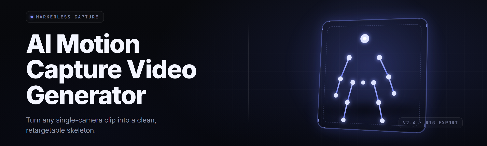

  
  
  

  

  
  

---

**ai-mocap-video-toolkit** is a Windows desktop toolkit that takes a plain video file — a phone clip, a webcam recording, a ripped movie scene — and turns the human performance inside it into clean, riggable motion data. No suits. No markers. No twelve-camera studio. Point it at footage, hit **Generate**, and it hands you a skeletal animation you can drop straight into Blender, Unreal, Unity, Maya, or Source Filmmaker.

It reads a person's body from the pixels, tracks 33 core joints plus hands and face, reconstructs depth from a monocular frame, and bakes a retarget-ready BVH or FBX. The whole pipeline runs on your own GPU. Your clips never leave the machine.

> **Full send:** see the FAQ for detection notes, update behavior, and what happens with occluded limbs.

  

---

## 📖 Table of Contents

- [What is the AI Motion Capture from Video Generator?](#-what-is-the-ai-motion-capture-from-video-generator)
- [Overview](#-overview)
- [Glossary — Terms You'll Hear](#-glossary--terms-youll-hear)
- [The Problem](#-the-problem)
- [The Solution](#-the-solution)
- [Quick Start](#-quick-start)
- [Comparison — Toolkit vs The Usual Routes](#-comparison--toolkit-vs-the-usual-routes)
- [Key Features](#-key-features)
- [Body Tracking Modules](#-body-tracking-modules)
- [Hand & Face Modules](#-hand--face-modules)
- [Depth & Reconstruction Modules](#-depth--reconstruction-modules)
- [Retargeting & Export Modules](#-retargeting--export-modules)
- [All Modules Status](#-all-modules-status)
- [System Requirements](#-system-requirements)
- [Installation](#-installation)
- [Usage Guidelines](#-usage-guidelines)
- [Hotkeys](#-hotkeys)
- [Known Issues](#-known-issues)
- [FAQ](#-faq)

---

## 🧭 Overview

| Category | Details |
|---|---|
| Product | AI Motion Capture from Video Generator (`ai-mocap-video-toolkit`) |
| Release | v2.4.1 · build 2026.02 |
| Format | Portable Windows `.exe` — extract, run, no installer |
| Input | MP4, MOV, MKV, WEBM, AVI, PNG/JPG image sequences |
| Output | BVH, FBX (ASCII + binary), GLB, JSON joint tracks, CSV |
| Engine bridges | Blender addon, Unreal Live Link, Unity plugin, SFM/VMD export |
| Inference | ONNX Runtime + DirectML, CUDA optional |
| Footage need | Single camera, 720p minimum, subject visible waist-up or full-body |

The generator's whole point is removing the gap between "I have footage" and "I have animation." A dance clip becomes a gameplay animation. A talking-head video becomes a face rig pass. A sports recording becomes a locomotion set. The toolkit handles the boring middle — detection, tracking, smoothing, retarget — so the artist starts from a rig, not a blank timeline.

---

## 📚 Glossary — Terms You'll Hear

| Term | Explanation |
|---|---|
| Monocular 3D | Reconstructing 3D joint positions from a single 2D camera feed using learned depth priors |
| Retargeting | Mapping a solved skeleton onto a *different* rig so proportions and bone names don't break |
| Occlusion | When a limb or body part is hidden behind something or out of frame; solver must guess |
| Root motion | The translation of the pelvis over time — drives character movement across the world |
| Jitter | Frame-to-frame noise in joint positions that reads as vibration without temporal filtering |
| IK pass | Inverse-kinematics clean-up that keeps feet planted and hands locked instead of floating |
| Confidence score | Per-joint certainty value; low scores flag joints the solver isn't sure about |

---

## 🩹 The Problem

- You film perfect footage and still get **joints popping and sliding** because there's no temporal smoothing and no ground-plane lock.
- Suit-based mocap costs five figures and a dedicated room; phone-to-rig pipelines are the only realistic route for solo creators.
- Most 2D pose estimators give you **x/y only** — no depth — so the result can't be used for real 3D animation.
- Retargeting is where everything dies: bone names differ, rest poses differ, scale differs, and you spend the day in the rig editor instead of animating.
- Foot sliding, floating feet, and drifting hips make the data unusable for locomotion without hand-fixing every frame.
- Facial and finger detail is usually thrown away entirely, leaving you with a stiff mannequin that reads as robotic.
- Delivered formats don't match what your engine wants — you get one output and pray it imports.

---

## 💡 The Solution

| Problem | Solution |
|---|---|
| Joints pop and slide | Temporal filter + IK pass + ground-plane lock baked into the pipeline |
| Suit cost | Single-camera video pipeline, no hardware beyond a GPU |
| 2D-only pose | Monocular 3D lift with learned depth priors and root translation |
| Retargeting pain | Built-in retarget presets for Blender, Unreal, Unity, Maya, SFM rigs |
| Foot sliding | Foot-lock solver that pins contact frames and propagates root motion |
| Lost face/fingers | Dedicated hand (21pt) and face (478pt) solvers joined to the body track |
| Format mismatch | Seven export formats plus live-link bridges — pick the one your engine eats |

---

## ⚙️ Quick Start

1. 📦 Download the toolkit archive from the project page and extract it to a folder you own (not `Program Files`).
2. 🖱️ Double-click the `.exe` — the app opens to an empty project window.
3. 🎥 Drag a video file (MP4/MOV/MKV) onto the drop zone, or **File → Open Clip**.
4. 🧩 Pick a preset: **Full Body + Hands**, **Face Only**, or **Gameplay Locomotion**. Hit **Generate**.
5. 💾 When the timeline fills, click **Export** and choose your target format (BVH/FBX/GLB) or engine bridge.

First run pulls the model weights into `\models` next to the `.exe`. After that, every clip is processed locally with no network calls.

---

## 🆚 Comparison — Toolkit vs The Usual Routes

| Aspect | Alternative | This Toolkit |
|---|---|---|
| Hardware | Suit + multi-cam studio | One consumer GPU, any camera |
| Cost | $$$$ hardware + software seats | Free portable `.exe` |
| Setup time | Days of calibration | Minutes — extract and run |
| Depth data | Only with stereo rigs | Monocular 3D from single feed |
| Retarget | Manual bone remap | Preset bridges for major rigs |
| Face + fingers | Rare, expensive add-ons | Included in body pass |
| Offline | Cloud pose APIs send your clip out | Fully local inference |

---

## 🧪 Key Features

| Feature | Description | Benefit |
|---|---|---|
| Multi-format ingest | Decodes MP4, MOV, MKV, WEBM, AVI and still sequences at any fps | Drop whatever footage you have |
| Monocular 3D lift | Reconstructs depth from one camera using learned priors | Real 3D animation, no depth cam |
| Root motion extraction | Isolates pelvis translation as a clean world track | Locomotion that travels correctly |
| Foot-lock IK | Pins ground-contact frames and stops floating feet | Usable walk/run cycles |
| Temporal smoothing | Confidence-weighted filter kills joint jitter | Data that animates clean |
| Hand solver | 21-keypoint per hand, left and right | Grips, gestures, instrument play |
| Face solver | 478 landmark mesh with blendshape export | Talking-head and expression work |
| Retarget presets | Bone maps for Blender, UE, Unity, Maya, SFM | Skip the rig editor |
| Engine bridges | Gizmo addon, Live Link, Unity plugin | Live in your DCC or engine |
| Batch queue | Process a folder of clips back-to-back | Rushes through a shoot day |
| GPU acceleration | DirectML or CUDA execution provider | 2–6× faster passes |
| Offline by default | No telemetry, no cloud, no account | Your footage stays yours |

---

  

---

## 🦴 Body Tracking Modules

- **Torso Solver** — locks spine, chest, and pelvis chain and stabilizes the upper body before limbs attach.
- **Limb Solver** — tracks all 33 core body keypoints across occlusion using motion prediction.
- **Root Motion Track** — extracts pelvis translation as its own curve so characters travel instead of moonwalking.
- **Foot-Lock IK** — detects contact frames and pins them, ending sliding and floating feet.
- **Skeleton Smoother** — confidence-weighted temporal filter removes per-frame vibration.
- **Occlusion Healer** — interpolates limbs hidden behind props or cropped out of frame.
- **Multi-Person Splitter** — separates two or more subjects into independent tracks before solving.
- **Camera Shake Compensator** — removes handheld drift so the subject stays world-anchored.

---

## ✋ Hand & Face Modules

- **Hand Solver (Left/Right)** — 21 keypoints per hand for grips, finger articulation, and gesture capture.
- **Face Mesh Solver** — 478-landmark facial mesh tracked per frame.
- **Blendshape Baker** — converts the face mesh into ARKit-style blendshape curves for rigs.
- **Eye Gaze Estimator** — derives pupil direction for look-at animation.
- **Hand-Body Joiner** — welds hand tracks onto the arm chain without seams.
- **Jaw & Lip Sync Track** — isolates mouth motion for dialogue passes.

---

## 🧊 Depth & Reconstruction Modules

- **Depth Prior Engine** — predicts a depth map per frame from a single image.
- **3D Joint Lifter** — lifts 2D keypoints into 3D space using depth plus bone-length constraints.
- **Scale Calibrator** — infers real-world scale from reference height so exports are unit-correct.
- **Ground-Plane Fitter** — finds the floor plane and aligns the whole solve to it.
- **Rolling-Shutter Fixer** — compensates for skew on fast phone footage.

---

## 🔀 Retargeting & Export Modules

- **Blender Addon Bridge** — sends solved animation straight onto an armature in Blender.
- **Unreal Live Link** — streams frames into UE in real time.
- **Unity Plugin** — imports a solved clip onto a Humanoid rig.
- **Maya FBX Writer** — exports ASCII or binary FBX with correct bone hierarchy.
- **GLB Exporter** — packs the rig and animation into one portable file.
- **VMD / SFM Exporter** — outputs Source Filmmaker and MMD motion files.
- **Batch Encoder** — exports a whole queue to a chosen format unattended.

---

## 📊 All Modules Status

| Module | Status | Description |
|---|---|---|
| Torso Solver | ✅ Working | Spine/chest/pelvis chain lock and stabilization |
| Limb Solver | ✅ Working | 33-keypoint body tracking with occlusion prediction |
| Root Motion Track | ✅ Working | Pelvis translation export as world curve |
| Foot-Lock IK | ✅ Working | Contact-frame pinning, no foot slide |
| Skeleton Smoother | ✅ Working | Temporal jitter removal |
| Occlusion Healer | ✅ Working | Limb interpolation behind props/crop |
| Multi-Person Splitter | ✅ Working | Independent tracks for 2+ subjects |
| Camera Shake Compensator | ✅ Working | Handheld drift removal |
| Hand Solver L/R | ✅ Working | 21-point per-hand capture |
| Face Mesh Solver | ✅ Working | 478-landmark face track |
| Blendshape Baker | ✅ Working | ARKit-style curve output |
| Eye Gaze Estimator | ✅ Working | Pupil look-at direction |
| Hand-Body Joiner | ✅ Working | Seamless hand-to-arm weld |
| Jaw & Lip Sync Track | ✅ Working | Mouth motion for dialogue |
| Depth Prior Engine | ✅ Working | Per-frame monocular depth |
| 3D Joint Lifter | ✅ Working | 2D→3D lift with bone constraints |
| Scale Calibrator | ✅ Working | Real-world unit inference |
| Ground-Plane Fitter | ✅ Working | Floor alignment for the solve |
| Rolling-Shutter Fixer | ✅ Working | Skew compensation on fast footage |
| Blender Addon Bridge | ✅ Working | Solved anim onto Blender armature |
| Unreal Live Link | ✅ Working | Real-time stream to UE |
| Unity Plugin | ✅ Working | Humanoid rig clip import |
| Maya FBX Writer | ✅ Working | ASCII/binary FBX export |
| GLB Exporter | ✅ Working | Packed rig + animation |
| VMD / SFM Exporter | ✅ Working | SFM and MMD motion files |
| Batch Encoder | ✅ Working | Unattended queue export |

---

## 🖥️ System Requirements

| Component | Minimum | Recommended |
|---|---|---|
| OS | Windows 10 64-bit (1909+) | Windows 11 23H2+ |
| CPU | Quad-core 2.5 GHz | 8-core 3.5 GHz+ |
| RAM | 8 GB | 16 GB+ |
| GPU | DirectX 12, 4 GB VRAM | NVIDIA RTX 30-series+, 8 GB+ VRAM |
| Disk | 3 GB for app + weights | 10 GB+ for project cache |
| Footage | 720p, 30 fps | 1080p–4K, 30–60 fps |
| Runtime | DirectML (bundled) | CUDA 12 (optional) |

---

## 📥 Installation

1. **Download & extract.** Grab the archive from the project page and extract it to a folder you own. Do not run it from inside `Program Files` or a zip preview — the app writes weights and cache next to the executable.
2. **First launch.** Double-click the `.exe`. It verifies your GPU, creates `\models` and `\cache`, and downloads nothing over the network. If Windows SmartScreen warns about an unsigned build, click **More info → Run anyway**.
3. **Verify the pipeline.** Open **Help → System Check**. It runs a two-second self-test clip and green-lights the solver chain. When all rows are green, you're ready to drop real footage.

---

## ✅ Usage Guidelines

| Allowed | Not allowed |
|---|---|
| Capturing motion from footage you own or have rights to | Processing footage of people without their consent |
| Using exports in your games, films, and student projects | Redistributing the app's model weights as your own |
| Offline commercial use of the *output* animation | Bypassing the local-only inference to server-farm the models |
| Modding the addons and bridges for your own pipeline | Re-uploading the portable `.exe` as a paid product |

---

## ⌨️ Hotkeys

| Key | Action |
|---|---|
| `Space` | Play / pause the preview |
| `G` | Generate motion from the loaded clip |
| `E` | Open the export dialog |
| `L` | Toggle skeleton overlay |
| `H` | Toggle hand tracking view |
| `F` | Toggle face mesh overlay |
| `Ctrl+B` | Add clip to batch queue |
| `Ctrl+Z` | Undo last solver parameter change |

---

## 🐞 Known Issues

| Issue | Solution |
|---|---|
| Feet still slide on treadmill footage | Disable **Root Motion Track**, enable **Foot-Lock IK** only |
| Face mesh flickers fast on low light | Lower the **Detection Threshold** in Face settings |
| CUDA not detected | Install CUDA 12 runtime, or switch the engine to DirectML |
| Two subjects merge into one track | Raise **Person Count** in the Multi-Person Splitter panel |
| Export is in wrong units | Run **Scale Calibrator** with the subject's real height first |
| App closes on launch after update | Delete `\cache` and relaunch to rebuild the shader cache |

---

## ❔ FAQ

Does this need internet after the first run?

No. Weights live in `\models` next to the `.exe`. Inference is fully local — no cloud pose API, no account, no telemetry.

What happens to the app on update?

Updates are a manual drop-in: replace the `.exe` and any changed modules. Your projects, cache, and weights stay where they are.

Will it read an occluded limb correctly?

The Occlusion Healer interpolates short gaps using motion prediction. Long full-frame occlusions — a limb off-screen for more than ~30 frames — will drift and need a manual key.

Which footage gives the cleanest solve?

Full-body, steady camera, good light, subject in frame waist-up or better, no fast motion blur. 1080p at 30–60 fps is the sweet spot.

Can it handle more than one person?

Yes — the Multi-Person Splitter separates subjects into independent tracks before solving. Two to four is comfortable; beyond that, keep the camera steady and subjects spaced.

Do I need admin rights?

No. Extract and run from any folder you own. Admin is only needed if you install the optional CUDA runtime system-wide.

What formats can I export to?

BVH, FBX (ASCII + binary), GLB, JSON joint tracks, CSV, plus VMD/SFM motion. Engine bridges push directly to Blender, Unreal, and Unity.

Is my footage uploaded anywhere?

Never. The toolkit has no network path during processing. Everything happens on your GPU, on your machine.

Why does the first generate take longer?

First run compiles shaders and warms the ONNX execution provider. Subsequent clips on the same session are noticeably faster.

Can I batch a whole shoot?

Yes — queue a folder with `Ctrl+B` and hit **Batch Encode**. It walks every clip and exports to your chosen format unattended.

---

## 🎯 The Solution, In One Line

You feed it video, it hands back animation. The generator does the tracking, the 3D lift, the smoothing, and the export — offline, on your GPU, in whatever format your engine eats. Footage in, rig-ready motion out.

  

---

*ai-mocap-video-toolkit — released under MIT, built and maintained by people who'd rather animate than hand-key every frame. Absolute potato, chef.*
